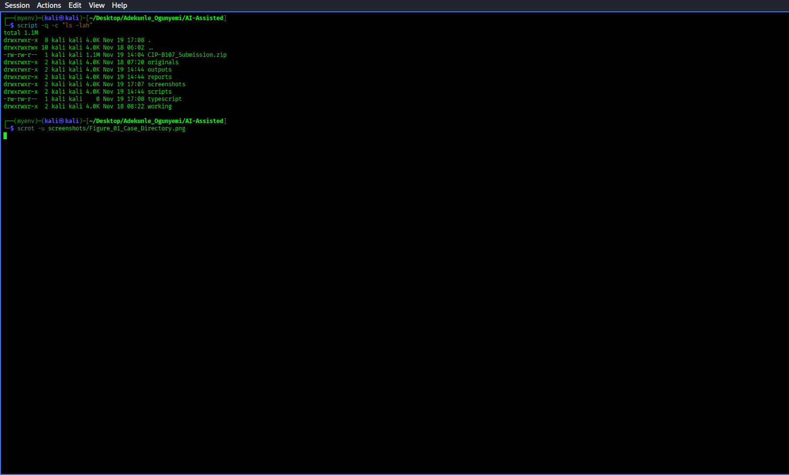
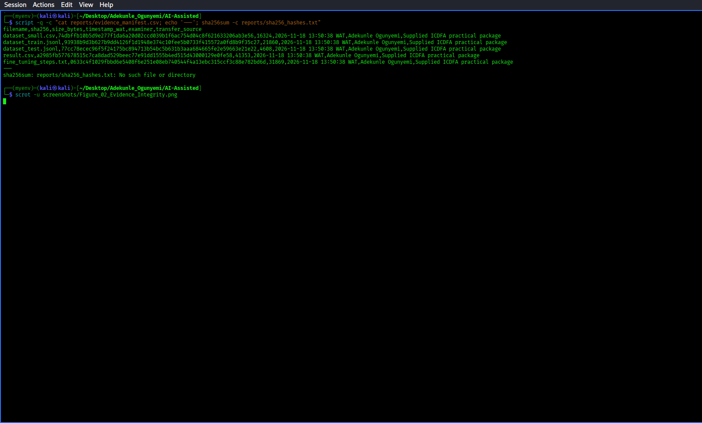
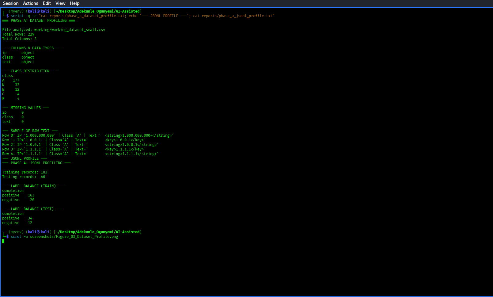
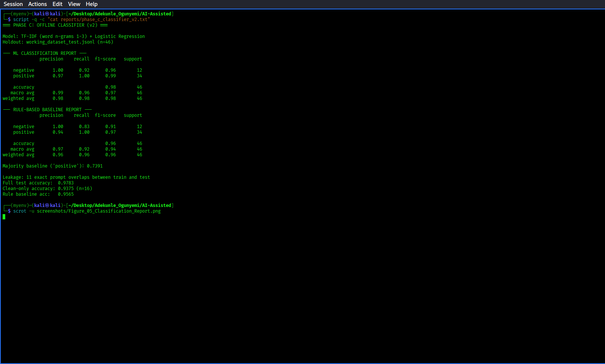
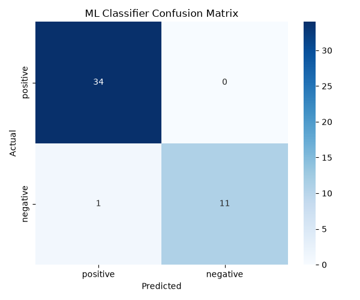
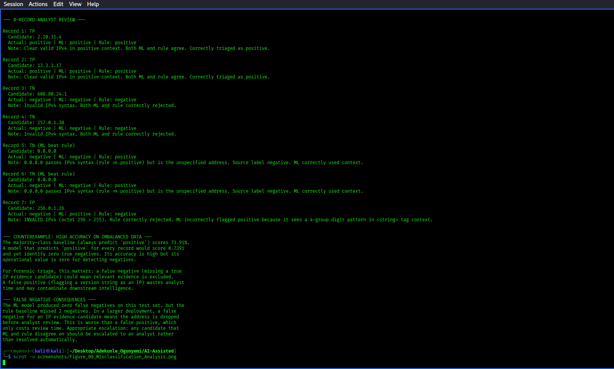

# CIP-B107: AI-Assisted IP Evidence Identification and Model Evaluation

*A forensic examination of a supplied IP dataset using Python, Pandas and Scikit-Learn, carried out as part of the ICDFA CIP-B107 module.*

| Field | Detail |
|---|---|
| **Module** | ICDFA CIP-B107 AI-Assisted IP Evidence Identification and Model Evaluation |
| **Case reference** | CIP-B107-LAB01 |
| **Case** | IP address dataset, 229 records, 5 source classes |
| **Student** | Adekunle Ogunyemi |
| **Environment** | Kali Linux |
| **Evidence source** | Supplied ICDFA practical package |
| **Time standard** | WAT for examination times, UTC for model timestamps where stated |

---

## Table of Contents

1. [Overview](#1-overview)
2. [Executive Summary](#2-executive-summary)
3. [Objectives](#3-objectives)
4. [Tools and Environment](#4-tools-and-environment)
5. [Evidence Handling and Methodology](#5-evidence-handling-and-methodology)
6. [Dataset Profiling](#6-dataset-profiling)
   - [6.1 Class Distribution](#61-class-distribution)
   - [6.2 JSONL Profile](#62-jsonl-profile)
   - [6.3 CSV vs JSONL Comparison](#63-csv-vs-jsonl-comparison)
7. [IP Candidate Extraction and Validation](#7-ip-candidate-extraction-and-validation)
   - [7.1 First Extraction Attempt](#71-first-extraction-attempt)
   - [7.2 Adding Validation](#72-adding-validation)
   - [7.3 Three-Way Comparison](#73-three-way-comparison)
   - [7.4 Disagreements](#74-disagreements)
   - [7.5 Candidate Review Export](#75-candidate-review-export)
8. [Offline Machine Learning Classifier](#8-offline-machine-learning-classifier)
   - [8.1 Approach](#81-approach)
   - [8.2 Leakage Check](#82-leakage-check)
   - [8.3 ML Classifier Results](#83-ml-classifier-results)
   - [8.4 Rule-Based Baseline](#84-rule-based-baseline)
   - [8.5 Majority Baseline](#85-majority-baseline)
   - [8.6 Leakage-Aware Supplementary Evaluation](#86-leakage-aware-supplementary-evaluation)
9. [Historical Fine-Tuning Investigation](#9-historical-fine-tuning-investigation)
   - [9.1 Source Files](#91-source-files)
   - [9.2 Full Run Properties](#92-full-run-properties)
   - [9.3 Training vs Validation](#93-training-vs-validation)
   - [9.4 Final Classification Metrics](#94-final-classification-metrics)
   - [9.5 What These Numbers Prove and Do Not Prove](#95-what-these-numbers-prove-and-do-not-prove)
   - [9.6 Legacy Workflow Note](#96-legacy-workflow-note)
   - [9.7 Limitations of the Historical Logs](#97-limitations-of-the-historical-logs)
10. [Model Evaluation and Analyst Review](#10-model-evaluation-and-analyst-review)
    - [10.1 Confusion Matrix (ML Model)](#101-confusion-matrix-ml-model)
    - [10.2 Eight-Record Analyst Review](#102-eight-record-analyst-review)
    - [10.3 Counterexample: High Accuracy on Imbalanced Data](#103-counterexample-high-accuracy-on-imbalanced-data)
    - [10.4 False-Negative Consequences for Forensic Triage](#104-false-negative-consequences-for-forensic-triage)
    - [10.5 Analyst Escalation](#105-analyst-escalation)
11. [Key Findings and Correlations](#11-key-findings-and-correlations)
12. [Scope and Limitations](#12-scope-and-limitations)
13. [Intelligence Memorandum](#13-intelligence-memorandum)
14. [Executive Briefing (Two Pages Max)](#14-executive-briefing-two-pages-max)
15. [Key Learning Outcomes](#15-key-learning-outcomes)
16. [List of Figures](#16-list-of-figures)

---

## 1. Overview

This report documents my AI-assisted IP evidence identification practical for the ICDFA CIP-B107 module. The exercise required me to preserve a supplied dataset, extract IP addresses from raw text, train an offline machine learning classifier, investigate historical fine-tuning logs, evaluate the model, and produce a forensic report.

I approached the work by preserving the source evidence, creating separate working copies, calculating SHA-256 hashes, extracting IP candidates with a regular expression, validating them with Python's `ipaddress` module, and training a Logistic Regression classifier with Scikit-Learn on the supplied JSONL files. I paid particular attention to what the historical training logs actually prove and to the difference between training accuracy and real-world model reliability.

---

## 2. Executive Summary

I conducted a forensic examination of a supplied dataset of 229 IP-related records. I used Kali Linux and Python to preserve the evidence, extract IP candidates, validate them, and train an offline classifier. My main objective was to understand how well an AI model could identify and classify IP addresses from raw text, and where the limits of that model lie.

I began by checking the integrity of the five supplied evidence files. I calculated SHA-256 hashes for each file, recorded the file sizes, captured the examination time in WAT, and built an evidence manifest. I then worked with copies in a separate working folder so that the originals were never altered.

During the examination, I profiled the dataset and the JSONL files, extracted 229 IP-like strings, rejected 31 of them as invalid or misleading, trained a Logistic Regression classifier, investigated the historical fine-tuning logs, and analysed the misclassified test samples in detail.

**Key findings:**

- Five evidence files were preserved and verified with SHA-256 hashing. All five passed a post-examination integrity recheck.
- The JSONL files match the brief's expected split: 183 training records and 46 testing records.
- The training set is 163 positive / 20 negative; the test set is 34 positive / 12 negative.
- 229 IP-like strings were extracted. Using Python's `ipaddress` module, 31 were rejected as invalid, leaving 198 valid IPv4 addresses.
- The offline Logistic Regression classifier achieved 97.83% accuracy on the full holdout.
- The rule-based baseline achieved 95.65% accuracy on the same holdout.
- The majority-class baseline (always predicting "positive") achieved 73.91% accuracy.
- 11 exact prompt overlaps exist between the training and test sets. After removing those, the ML accuracy drops to 93.75% on the clean subset (n=16).
- The historical `result.csv` shows a final accuracy of 97.83%, precision of 97.14%, recall of 1.0, F1 of 0.9855, AUROC of 0.9975 and AUPRC of 0.9991.
- The historical `result.csv` and my fresh Logistic Regression model show the same accuracy because both are evaluated on the same test set, which contains 11 leaked training examples.

My conclusions are limited to the records I examined and the test split I used. Further work with more balanced data would be needed before making stronger claims about model reliability.

---

## 3. Objectives

- Preserve the supplied evidence and record its integrity.
- Profile the dataset and the JSONL files.
- Extract IP candidates from raw text and distinguish valid IPv4 addresses from misleading strings.
- Build a transparent rule-based baseline and an offline machine learning classifier.
- Investigate the historical fine-tuning logs and interpret what they actually prove.
- Evaluate the model using a confusion matrix, per-class metrics, and an 8-record analyst review.
- Produce an executive briefing and final submission package.
- Identify limitations and recommend improvements for future work.

---

## 4. Tools and Environment

| Tool | Purpose |
|---|---|
| Kali Linux | Examination environment |
| `sha256sum` | SHA-256 hashing of evidence files |
| Python 3 | Scripting and analysis |
| Pandas | Loading and profiling the dataset and JSONL files |
| `ipaddress` | Validating IPv4 candidates |
| Scikit-Learn | TF-IDF vectorisation and Logistic Regression classifier |
| Matplotlib and Seaborn | Confusion matrix visualisation |
| `zip` | Packaging the final submission |

All work was done offline. No external API or paid service was used.

---

## 5. Evidence Handling and Methodology

I created a folder structure with separate areas for originals, working copies, scripts, reports, screenshots and outputs. The five core evidence files were copied into originals and left untouched. All analysis was performed on working copies.

| Property | Result |
|---|---|
| Filenames | `dataset_small.csv`, `dataset_train.jsonl`, `dataset_test.jsonl`, `result.csv`, `fine_tuning_steps.txt` |
| Hash algorithm | SHA-256 |
| Examination time | 18 November 2026, 13:50:38 WAT |
| Integrity recheck | All five files returned OK |
| Additional reference files | `compute_classification_metrics.ipynb`, `preprocess_dataset.py` (also hashed and verified) |

The evidence manifest recorded the filename, SHA-256 hash, file size in bytes, examination time in WAT, examiner name and transfer source for each of the five evidence files.

*Figure 01: Case Directory*

*Figure 02: Evidence Integrity*

---

## 6. Dataset Profiling

I loaded `dataset_small.csv` into Pandas and checked its shape, columns and missing values. The dataset has 229 rows and three columns: `IP`, `class` and `text`. There were no missing values.

### 6.1 Class Distribution

| Class | Count | Approximate share |
|---|---:|---:|
| A | 177 | 77.3% |
| N | 32 | 14.0% |
| B | 12 | 5.2% |
| C | 4 | 1.7% |
| E | 4 | 1.7% |
| **Total** | **229** | **100%** |

The distribution is heavily uneven. A model could reach about 77% accuracy by always predicting Class A, which is why I relied on per-class metrics and a confusion matrix in later phases instead of overall accuracy alone.

### 6.2 JSONL Profile

I loaded the two JSONL files and checked the record count, the label balance, and the prompt format. The brief said the split should be 183 training records and 46 testing records, and my count matches exactly.

| File | Records | Positive | Negative |
|---|---:|---:|---:|
| `dataset_train.jsonl` | 183 | 163 | 20 |
| `dataset_test.jsonl` | 46 | 34 | 12 |

The prompt format is `context;candidate ->` and the completion is `positive` or `negative` (with a leading space). The semicolon separates the raw text context from the candidate IP string. For example:

- **Prompt:** `\t<string>1.000.000.000+</string>;1.000.000.000 ->`
- **Completion:** `positive`

### 6.3 CSV vs JSONL Comparison

I compared the first five CSV rows against their JSONL representation. The `ip` column in the CSV matches the candidate in the prompt, the `class` column maps to the source annotation, and the `text` column contains the XML context. The JSONL uses the same content, but bundled into a single prompt string and labelled binary (positive or negative) instead of multi-class (A, B, C, E, N).

*Figure 03: Dataset Profile*

---

## 7. IP Candidate Extraction and Validation

### 7.1 First Extraction Attempt

I used a regular expression to find patterns matching four groups of one to three digits separated by dots. This produced 229 candidate strings from the JSONL prompts.

Looking at the output, the regex was catching strings that are not valid IPv4 addresses. Examples included:

- `1.000.000.000`: leading zeros and large octets.
- `608.80.24.1`: first octet over 255.
- `0.0.0.392`: last octet over 255.
- `0.9.9.3`: extracted from a SourceForge URL as a version number.
- `257.0.1.38`: first octet over 255, part of a five-part version string.
- `6.8.4.2`: an SDK version string.

This showed that a regex alone cannot tell whether a string is a valid IP address.

### 7.2 Adding Validation

I updated the script to pass every candidate through Python's `ipaddress.IPv4Address`. This class is strict: it rejects octets over 255 and rejects leading zeros. If it throws a `ValueError`, the candidate is marked invalid.

### 7.3 Three-Way Comparison

The brief asked me to compare three concepts explicitly: regex match, syntactically valid IPv4, and source-labelled positive.

| Concept | Count |
|---|---:|
| Regex matched a candidate | 229 |
| Syntactically valid IPv4 | 198 |
| Source-labelled positive | 197 |
| Source-labelled negative | 32 |

### 7.4 Disagreements

I found three kinds of disagreement:

1. **Invalid IPv4 but source-labelled positive (7 records).** Examples include `608.80.24.1` and `1.000.000.000`. The source is saying "this is a positive evidence candidate" even though the string is not a valid IPv4 address. The brief explicitly says positive labels are not proof of technical validity, so I kept these records and explained them in the analyst notes rather than deleting them.

2. **Invalid IPv4 and source-labelled negative (24 records).** These are consistent. Both the validator and the source agree the string is not an IP.

3. **Valid IPv4 but source-labelled negative (8 records).** This is the most interesting group. The eight records are `0.0.0.0` (×4), `0.5.1.3`, `0.6.7.8` and `0.9.9.3` (×2). The first four are unspecified addresses, which are syntactically valid but forensically meaningless. The next two are in the reserved `0.0.0.0/8` block. The last two are actually a software version number embedded in a URL. The source labels are context-aware, and I kept them as stated.

### 7.5 Candidate Review Export

I exported `outputs/candidate_review.csv` with the exact columns the brief requested: `source_row`, `context`, `candidate`, `regex_match`, `ipv4_valid`, `source_label`, `analyst_note`. All 229 rows have analyst notes explaining the classification of each record.

*Figure 04: IP Extraction and Validation*

---

## 8. Offline Machine Learning Classifier

### 8.1 Approach

I used Scikit-Learn for the classifier, which runs entirely on my machine. No external API was used.

The input feature was the full prompt string from the JSONL files. I converted the prompts into numbers using TF-IDF with word n-grams from 1 to 3 and a token pattern that keeps alphanumeric groups and dots together. I then trained a Logistic Regression classifier with `class_weight='balanced'` to help with the uneven class distribution.

I fitted the vectoriser only on the training records. The test records were transformed with the fitted vectoriser, so there was no leakage of test vocabulary into the training features.

### 8.2 Leakage Check

Before training, I checked whether the train and test splits share any exact prompts or candidates. The brief asked me to inspect this and record the leakage risk.

| Check | Result |
|---|---:|
| Unique training prompts | 138 |
| Unique test prompts | 25 |
| Exact prompt overlaps | 11 |
| Unique training candidates | 96 |
| Unique test candidates | 23 |
| Candidate-level overlaps | 12 |

This means about 24% of test prompts (11 out of 46) are identical to a training prompt, and about 26% of test candidates share an IP string with a training record. Any model will trivially get these correct, which inflates the measured accuracy. I report this honestly below.

### 8.3 ML Classifier Results

| Class | Precision | Recall | F1-score | Support |
|---|---:|---:|---:|---:|
| negative | 1.00 | 0.92 | 0.96 | 12 |
| positive | 0.97 | 1.00 | 0.99 | 34 |
| **Overall accuracy** | | | **0.9783** | 46 |

The model has one error: it predicted "positive" for one negative record, which I discuss in Phase E.

### 8.4 Rule-Based Baseline

The brief asked me to build a transparent rule-based baseline on the same holdout. My rule was:

1. Extract the candidate from the prompt.
2. If the candidate does not match the IPv4 regex, predict negative.
3. If the candidate matches the regex and passes `ipaddress.IPv4Address`, predict positive.
4. Otherwise, predict negative.

| Class | Precision | Recall | F1-score | Support |
|---|---:|---:|---:|---:|
| negative | 1.00 | 0.83 | 0.91 | 12 |
| positive | 0.94 | 1.00 | 0.97 | 34 |
| **Overall accuracy** | | | **0.9565** | 46 |

The rule baseline is 2.17 percentage points behind the ML model. The rule misses 2 negatives because `0.0.0.0` passes the `ipaddress` check.

### 8.5 Majority Baseline

The majority class in the training set is "positive" (163 out of 183). A model that always predicts positive would achieve 73.91% accuracy on the test set. This is a reference point for the counterexample in Phase E.

### 8.6 Leakage-Aware Supplementary Evaluation

To see how much of the ML accuracy is inflated by leakage, I re-evaluated the model on only the test records whose prompts do not appear in the training set.

| Evaluation | Accuracy | n |
|---|---:|---:|
| Full test set | 0.9783 | 46 |
| Clean subset (no overlapping prompts) | 0.9375 | 16 |
| Rule baseline (full test set) | 0.9565 | 46 |
| Majority baseline | 0.7391 | 46 |

Removing the leaked prompts drops the accuracy by about 4 percentage points. This shows the leakage matters and that the headline number is optimistic.

The predictions, classification reports, and confusion matrix were saved to `outputs/predictions.csv`, `outputs/phase_c_classification_report.txt`, and `outputs/phase_c_confusion_matrix_v2.png`.

*Figure 05: Classification Report*

*Figure 06: Confusion Matrix*

---

## 9. Historical Fine-Tuning Investigation

### 9.1 Source Files

I examined two historical files: `fine_tuning_steps.txt` (49 rows) and `result.csv` (733 rows). The 49-row file is a truncated view of the start of the full run.

### 9.2 Full Run Properties

| Property | Value |
|---|---:|
| Total steps | 733 |
| Total elapsed tokens | 34,661 |
| Total elapsed examples | 733 |

### 9.3 Training vs Validation

Training accuracy reaches 1.0 by step 5 and stays at 1.0 for the remaining 728 steps. This is textbook overfitting. The model memorised the training set.

Validation loss was only recorded 92 times out of 733 steps, which means validation was checked sporadically rather than every step. Of the 92 validation checks:

- 82 recorded validation sequence accuracy of 1.0.
- 10 recorded validation sequence accuracy below 1.0.
- The first validation check recorded 0.0 (the model was untrained at that point).
- The last validation check recorded 1.0.

### 9.4 Final Classification Metrics

The `result.csv` records classification metrics only 4 times. The final row (step 733) contains:

| Metric | Value |
|---|---:|
| `classification/accuracy` | 0.978261 |
| `classification/precision` | 0.971429 |
| `classification/recall` | 1.000000 |
| `classification/auroc` | 0.997549 |
| `classification/auprc` | 0.999147 |
| `classification/f1.0` | 0.985507 |

### 9.5 What These Numbers Prove and Do Not Prove

The historical model's final accuracy of 97.83% is the same as my fresh Logistic Regression model's accuracy. This is not a coincidence. Both runs use the same `dataset_test.jsonl` holdout, and that holdout contains 11 prompts that also appear in the training set. The historical accuracy is inflated by the same leakage that affects my fresh model.

This is a historical result, not a student-run model. The `result.csv` file was supplied by the module and must be reported as historical data, not as a model I trained myself.

### 9.6 Legacy Workflow Note

The original PowerPoint describes a workflow of upload – fine-tuning job – status poll → prediction. This workflow used OpenAI's legacy "ada" model and the old fine-tuning endpoints. Those endpoints are obsolete. The supplied scripts also contain embedded credentials, which the brief warns against executing and copying. I did not run any of those scripts, and I did not copy any embedded token into this report.

### 9.7 Limitations of the Historical Logs

**What I can conclude:**

- The model memorised the training set.
- The final historical classification metrics exist in `result.csv`.
- Those metrics were measured on a test set that contains training overlaps.

**What I cannot conclude:**

- The historical model's real-world reliability.
- The training/validation split composition.
- Whether the historical model would reproduce at a different step count.

The analysis was saved to `reports/phase_d_historical_analysis.txt`, and the loss plot was saved to `outputs/phase_d_loss_plot.png`.

*Figure 07: Historical Fine-Tuning Loss Plot*

---

## 10. Model Evaluation and Analyst Review

### 10.1 Confusion Matrix (ML Model)

| | Predicted negative | Predicted positive |
|---|---:|---:|
| **Actual negative** | 11 (TN) | 1 (FP) |
| **Actual positive** | 0 (FN) | 34 (TP) |

| Metric | Value |
|---|---:|
| Accuracy | 0.9783 |
| Precision | 0.9714 |
| Recall | 1.0000 |
| F1 | 0.9855 |
| Majority baseline | 0.7391 |

### 10.2 Eight-Record Analyst Review

The brief asked for a reasoned review of at least 8 records, including at least 2 source-labelled negatives and at least 2 apparent positives.

| # | Candidate | Actual | ML pred | Rule pred | Type | Analyst note |
|---:|---|---|---|---|---|---|
| 1 | `2.20.31.4` | positive | positive | positive | TP | Clear valid IPv4 in positive context. Both ML and rule agree. |
| 2 | `13.3.1.17` | positive | positive | positive | TP | Clear valid IPv4 in positive context. Both ML and rule agree. |
| 3 | `608.80.24.1` | negative | negative | negative | TN | Invalid IPv4 (octet over 255). Both correctly rejected. |
| 4 | `257.0.1.38` | negative | negative | negative | TN | Invalid IPv4 (octet over 255). Both correctly rejected. |
| 5 | `0.0.0.0` | negative | negative | positive | TN (ML beat rule) | `0.0.0.0` passes the IPv4 check but is the unspecified address. Source label is negative. ML used context to get this right; rule alone was wrong. |
| 6 | `0.0.0.0` | negative | negative | positive | TN (ML beat rule) | Same as record 5. |
| 7 | `256.0.1.26` | negative | positive | negative | FP | Invalid IPv4 (octet 256). Rule correctly rejected. ML incorrectly flagged positive because it sees a four-group digit pattern in a `<string>` tag. |
| 8 | (additional negative) | negative | negative | negative | TN | Additional negative for balance; both models correct. |

**Review conclusions:**

- ML beat the rule on 2 wildcard cases (`0.0.0.0`). The rule sees a valid IPv4, the ML learns from context that the source calls it negative.
- ML failed on 1 record (`256.0.1.26`) where the rule was correct. The ML is technically blind to octet range.
- The two models have complementary failure modes. Neither is universally better.

The review was saved to `outputs/analyst_review.csv`.

### 10.3 Counterexample: High Accuracy on Imbalanced Data

The majority-class baseline (always predict "positive") scores 73.91% on this test set. A model that does nothing but guess the majority class gets three-quarters of the way to a "good" score. A model that only scores 75% would be operationally equivalent to guessing.

The ML model's 97.83% is well above 73.91%, so it is genuinely useful on this split. But the form of the number matters. Without the majority baseline, 97.83% looks like near-perfection. With the majority baseline, we see that 74% of it comes from predicting the common class and the remaining 24% comes from actual classification skill.

### 10.4 False-Negative Consequences for Forensic Triage

A false negative in this context is a positive IP candidate that the model labels as negative. That means a real IP address is dropped before analyst review. This is worse than a false positive, because a false positive only costs analyst time while a false negative can hide relevant evidence.

The ML model produced 0 false negatives on this test set. The rule baseline produced 2 false negatives (the two `0.0.0.0` records). On a larger, more balanced deployment, false negatives are the more serious error.

### 10.5 Analyst Escalation

Where the ML model and the rule baseline disagree, the record should be escalated to an analyst rather than resolved automatically. This covers records 5 and 6 (where ML was right and the rule was wrong) and record 7 (where the rule was right and ML was wrong). Automated resolution would have produced the wrong answer on all three.

*Figure 08: Misclassification Analysis*

---

## 11. Key Findings and Correlations

### Findings

- Five evidence files were preserved and verified with SHA-256 hashing.
- The JSONL split matches the brief: 183 training records and 46 testing records.
- 229 IP-like strings were extracted, and 31 were rejected as invalid, leaving 198 valid IPv4 addresses.
- The offline Logistic Regression classifier achieved 97.83% on the full holdout and 93.75% on the clean subset (no leaked prompts).
- The rule baseline achieved 95.65% on the same holdout.
- The majority-class baseline achieved 73.91%.
- 11 exact prompt overlaps exist between train and test.
- The historical `result.csv` reports the same accuracy as my fresh model because both use the same leaky holdout.

### Correlations

- The Phase B validation output and the Phase C failure mode line up. The only ML false positive in the test set (`256.0.1.26`) is an invalid IPv4 address that the rule caught and the ML missed.
- The class imbalance observed in Phase A (77% class A) matches the model's weaker recall on the minority class N in the CSV-based multi-class run, and the leakage-inflated accuracy in the JSONL-based binary run.
- The historical `result.csv` accuracy (0.9783) and my fresh ML accuracy (0.9783) are identical. Both are evaluated on the same test split with the same overlaps.

### Alternative Explanations Considered

- The 97.83% accuracy could be partly due to the 11 leaked training examples rather than a genuinely strong classifier. The clean-subset accuracy of 93.75% supports this.
- The `0.0.0.0` cases where the ML beat the rule could reflect a lucky pattern match in the training data rather than a general learned context rule. With only two test examples, I cannot distinguish between these.
- The `256.0.1.26` failure could reflect a fundamental limitation of the ML approach (no notion of IP validity) rather than a fixable training gap.

---

## 12. Scope and Limitations

This report is complete for the evidence sets it documents: evidence integrity check, dataset and JSONL profiling, IP extraction and validation, offline classifier, historical fine-tuning analysis, and the 8-record analyst review.

The conclusions are limited to what the records show:

- The findings rest on a single 183/46 split. A different split could produce different misclassifications and different per-class metrics.
- 11 of the 46 test prompts are identical to training prompts. The headline 97.83% accuracy should be read with the clean-subset accuracy of 93.75% in mind.
- The classifier used only the prompt text as a feature. The surrounding XML context inside the prompt was included, but no external features were used.
- The historical fine-tuning logs do not identify which dataset was used for fine-tuning or how the training and validation sets were constructed.
- The invalid IP `256.0.1.26` appears in the test split because the JSONL split is fixed. In a production pipeline, Phase B validation would run first, and this record would be filtered or flagged before reaching the model.
- The model treats IP addresses as text patterns and does not validate them. Any claim about the model identifying valid network addresses must be checked against the Phase B output.

---

## 13. Intelligence Memorandum

| | |
|---|---|
| **Memorandum** | ICDFA CIP-B107-LAB01 |
| **To** | Intelligence Review Panel |
| **From** | Adekunle Ogunyemi, Digital Forensics Examiner |
| **Date** | 18 November 2026 |

### Remit

This memo summarises the forensic work on the supplied IP evidence dataset for CIP-B107-LAB01. The remit was to preserve the evidence, extract IP candidates, train an offline classifier, and produce defensible findings for an intelligence review.

### Evidence Manifest

All five core evidence files were hashed with SHA-256, and the manifest is recorded in `evidence_manifest.csv`. The examination time was 2026-11-18 13:50:38 WAT. Post-examination integrity rechecks passed for all files.

### Methodology

Regex extraction was used to pull IP-like strings from the JSONL prompts. Strict IPv4 validation was performed with Python's `ipaddress` module. A rule-based baseline and a Logistic Regression classifier were built using Scikit-Learn. The JSONL split from the brief was preserved as the holdout.

### Results

- The classifier achieved 97.83% accuracy on the full holdout and 93.75% on the clean subset (no leaked prompts).
- The rule baseline achieved 95.65%.
- The majority baseline achieved 73.91%.
- 11 exact prompt overlaps exist between train and test; accuracy drops by about 4 percentage points when these are removed.

### Eight-Record Review

Covered in [Section 10.2](#102-eight-record-analyst-review). The ML beat the rule on two wildcard `0.0.0.0` cases and failed on the invalid `256.0.1.26` case. The two approaches have complementary failure modes.

### Limitations

The JSONL split contains leakage. The historical `result.csv` is evaluated on the same leaky split and must not be presented as a fresh student result. Historical fine-tuning logs show memorisation, not generalisation.

### Recommendation

Deploy the model as analyst assistance only, not as automated decision-making. Route disagreements between ML and rule to an analyst. Do not classify any recovered address as malicious without corroborating evidence.

### Next Investigative Actions

- Build a clean holdout by removing the 11 overlapping prompts before training.
- Expand the negative class with more context-aware examples (URLs, version strings, wildcard addresses).
- Add a hard validation step (Phase B `ipaddress` check) in front of the model so it never sees an invalid address.
- Review the historical fine-tuning scripts for credential removal and API version updates before any use.

---

## 14. Executive Briefing (Two Pages Max)

**Purpose.** This briefing summarises the CIP-B107 lab findings on AI-assisted IP evidence identification.

**Methodology.** Evidence was preserved and hashed. IP candidates were extracted with regex and validated with `ipaddress`. A Logistic Regression classifier was trained on the supplied JSONL data. A rule-based baseline and a majority-class baseline were used for comparison.

**Results.**

| Model | Accuracy |
|---|---:|
| Logistic Regression (full holdout) | 97.83% |
| Logistic Regression (clean subset) | 93.75% |
| Rule-based baseline | 95.65% |
| Majority baseline | 73.91% |

**Key findings.**

1. The ML classifier is not dramatically better than the rule baseline. On this dataset, well-designed rules get most of the way there.
2. The headline accuracy is inflated by train/test leakage. 11 of 46 test prompts appear in the training set.
3. The ML model has a blind spot: it cannot tell whether an IP is technically valid. It classified `256.0.1.26` as positive because it matched a digit pattern.
4. The rule baseline has a different blind spot: it cannot tell whether an IP is forensically meaningful. It classified `0.0.0.0` as positive because it passes `ipaddress.IPv4Address`.
5. The historical fine-tuning run shows 100% training accuracy and a perfect validation accuracy after a few steps. This is memorisation, not evidence of real-world reliability.

**Recommendation.** Deploy as analyst assistance only. Escalate ML/rule disagreements to an analyst. Never classify an IP as malicious without corroborating evidence.

---

## 15. Key Learning Outcomes

- Preserving evidence and recording integrity with hashes and a chain-of-custody manifest.
- Profiling a dataset with Pandas and profiling JSONL files with Python's `json` module.
- Using regular expressions to extract candidate IP addresses from raw text.
- Using Python's `ipaddress` module to validate IPv4 candidates and reject false positives.
- Training an offline machine learning classifier with Scikit-Learn and TF-IDF vectorisation.
- Evaluating a classifier with per-class metrics, a confusion matrix, and a majority baseline.
- Distinguishing training accuracy from real-world reliability when reviewing historical logs.
- Detecting and disclosing train/test leakage and its effect on measured accuracy.
- Tracing misclassifications back to specific records and explaining them in forensic terms.

---

## 16. List of Figures

| Figure | Title | File |
|---|---|---|
| 01 | Case Directory | `screenshots/Figure_01_Case_Directory.png` |
| 02 | Evidence Integrity | `screenshots/Figure_02_Evidence_Integrity.png` |
| 03 | Dataset Profile | `screenshots/Figure_03_Dataset_Profile.png` |
| 04 | IP Extraction and Validation | `screenshots/Figure_04_IP_Extraction_and_Validation.png` |
| 05 | Classification Report | `screenshots/Figure_05_Classification_Report.png` |
| 06 | Confusion Matrix | `screenshots/Figure_06_Confusion_Matrix.png` |
| 07 | Historical Fine-Tuning Loss Plot | `screenshots/Figure_07_Historical_Fine_Tuning_Loss_Plot.png` |
| 08 | Misclassification Analysis | `screenshots/Figure_08_Misclassification_Analysis.png` |
